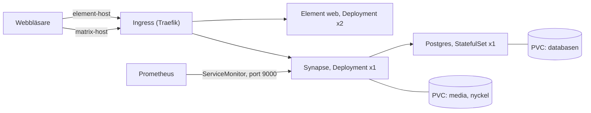

# Synapse-charten

En egen Helm-chart för Matrix Synapse, med Element web som webbklient och
Postgres som databas. Skriven från grunden. Argo CD deployar den från
`kubernetes/apps/templates/synapse.yaml`, med klustrets värden i
`kubernetes/values/synapse.yaml`.

## Delarna



Element är bara statiska filer. All logik körs i webbläsaren, som sedan
pratar direkt med Synapse-API:t. Därför två hostar: en för klienten och en
för API:t.

| Template | Vad | Varför så |
|---|---|---|
| `_helpers.tpl` | namn och labels | samma labels överallt, en plats att ändra |
| `postgres-statefulset.yaml` | databasen | fast poddnamn och egen volym, se nedan |
| `postgres-service.yaml` | headless service | StatefulSeten kräver en, ger DNS-namnet `synapse-postgres` |
| `synapse-configmap.yaml` | `homeserver.yaml` | går att ha i git, inget hemligt i den |
| `synapse-pvc.yaml` | volym för media och nyckel | en Deployment har inga `volumeClaimTemplates` |
| `synapse-deployment.yaml` | Matrix-servern | en replik, `Recreate` |
| `synapse-service.yaml` | port 8008 och 9000 | ingressen och Prometheus når Synapse här |
| `element-*.yaml` | webbklienten | statisk, kan ha flera repliker |
| `ingress.yaml` | två hostar med TLS | bara klient-API:t släpps ut |
| `servicemonitor.yaml` | säger åt Prometheus att skrapa | stacken hittar den i alla namespaces |
| `dashboard-configmap.yaml` | dashboarden i Grafana | sidecaren letar efter labeln `grafana_dashboard` |
| `NOTES.txt` | text efter install | hur man skapar första användaren |

## Valen, och varför

- **Postgres är en StatefulSet, inte en Deployment.** Podden får ett fast
  namn (`synapse-postgres-0`) och en egen PVC från `volumeClaimTemplates`.
  En Deployment kan starta den nya podden innan den gamla är borta, och två
  Postgres på samma datakatalog förstör databasen.
- **Synapse är en Deployment med en replik och `Recreate`.** Synapse utan
  workers är en enda process. Volymen är `ReadWriteOnce`, så en ny podd
  skulle vänta på volymen som den gamla håller. `Recreate` stoppar den gamla
  först.
- **Element har två repliker och vanlig RollingUpdate.** Inget sparas i
  podden, så det går att uppgradera utan avbrott.
- **Inga hemligheter i git.** Charten skapar ingen Secret. Den pekar ut
  `existingSecret`, som skapas av Ansible (rollen `app_secrets`) från
  CI-variabler. En slumpad Secret i charten fungerar inte med Argo CD: Argo
  renderar charten vid varje synk och skulle slumpa ett nytt lösenord varje
  gång, samma problem som med Grafanas lösenord.
- **Lösenordet till Postgres går som `PGPASSWORD`.** Synapse ansluter med
  psycopg2, som läser `PGPASSWORD` från miljön. Därför står inget lösenord i
  `homeserver.yaml` och filen kan vara en ConfigMap.
- **Registreringshemligheten är en fil**, `registration_shared_secret_path`.
  Med den skapas användare med `register_new_matrix_user`. Öppen
  registrering är avstängd.
- **Signeringsnyckeln skapas av Synapse** vid första start, på volymen. Den
  är serverns identitet och överlever omstarter.
- **Postgres måste ha locale C.** Synapse vägrar starta annars. Det går bara
  att välja när databasen skapas, därför `POSTGRES_INITDB_ARGS`.
- **Synapse väntar in Postgres** med en initContainer som kör `pg_isready`.
  Utan den kraschar Synapse vid varje nybygge tills databasen är uppe.
- **Konfigändringar startar om podden.** Annotationen `checksum/config` är en
  hash av ConfigMapen. Ändras konfigurationen ändras podden, och Deploymenten
  rullar ut en ny.
- **Icke-root.** Synapse kör som uid 991 och `fsGroup` gör volymen skrivbar.
  Element kör som uid 101 (nginx) på port 8080, eftersom en icke-root-process
  inte får lyssna på portar under 1024.
- **Admin-API:t släpps inte ut.** Ingressen skickar bara `/_matrix` och
  `/_synapse/client` till Synapse. `/_synapse/admin` och `/health` når man
  bara inifrån klustret.
- **Ingen federation.** Servern pratar inte med andra Matrix-servrar, så
  listenern har bara `client` och `trusted_key_servers` är tom.
- **Metrics på en egen port**, 9000, som inte går via ingressen.
- **Bara minnesgränser.** En CPU-gräns stryper processen även när noden har
  CPU över. Minnesgränsen skyddar resten av noden.

## Knopparna i values.yaml

| Värde | Standard | Vad |
|---|---|---|
| `serverName` | `matrix.example.com` | Matrix-namnet, del av alla användar-id. Går inte att byta efteråt. |
| `existingSecret` | `synapse-secrets` | Secreten med `postgres-password` och `registration-shared-secret` |
| `synapse.image.tag` | `v1.162.0` | Synapse-versionen |
| `synapse.resources` | 100m, 256Mi, max 1Gi | CPU och minne |
| `synapse.persistence.size` | `5Gi` | volym för media |
| `element.enabled` | `true` | stäng av webbklienten |
| `element.replicas` | `2` | antal Element-poddar |
| `postgres.persistence.size` | `5Gi` | volym för databasen |
| `ingress.synapseHost`, `ingress.elementHost` | `*.example.com` | hostarna |
| `ingress.tls.secretName` | tomt | tomt = Traefiks standardcertifikat |
| `metrics.enabled` | `true` | metrics-port, ServiceMonitor och dashboard |

## Testa lokalt i minikube

Utan Traefik och Prometheus, så ingress och ServiceMonitor stängs av.

```bash
minikube start -p synapse
kubectl create namespace synapse
kubectl -n synapse create secret generic synapse-secrets \
  --from-literal=postgres-password="$(openssl rand -hex 16)" \
  --from-literal=registration-shared-secret="$(openssl rand -hex 32)"
helm install synapse charts/synapse -n synapse \
  --set serverName=matrix.local \
  --set ingress.enabled=false \
  --set metrics.serviceMonitor.enabled=false
kubectl -n synapse get pods -w
```

Riv med `minikube delete -p synapse`.

## Övningar

Alla är testade i minikube 2026-10-10.

1. **Läs det renderade.** `helm template synapse charts/synapse | less`.
   Hitta var `serverName` hamnar. `helm lint charts/synapse` ska vara helt
   ren.
2. **Första användaren.** Följ `NOTES.txt` och logga in med API:t:
   `kubectl -n synapse port-forward svc/synapse 8008:8008`, sedan
   `curl -s localhost:8008/_matrix/client/versions`.
3. **Data överlever.** Ta bort både `synapse-postgres-0` och Synapse-podden.
   Användaren kan fortfarande logga in, och
   `sha256sum /data/signing.key` i podden ger samma hash som innan.
4. **Ta bort locale C.** Ta bort `POSTGRES_INITDB_ARGS` lokalt, avinstallera
   och ta bort PVC:n `data-synapse-postgres-0` (annars finns den gamla
   databasen kvar), installera igen. Synapse hamnar i CrashLoopBackOff, och
   loggen säger `Database has incorrect collation`.
5. **Ta bort `runAsUser: 101`** i Element. Poddarna hamnar i
   `CreateContainerConfigError`. `kubectl describe pod` säger varför.
6. **En konfigändring startar om podden.** `helm upgrade` med ett annat
   `ingress.synapseHost` och se poddnamnet bytas. Vad händer om du tar bort
   `checksum/config`?
7. **Spärren mot spam.** Skicka 20 meddelanden i rad med API:t. Bara ungefär
   10 kommer fram, resten får 429. Synapse begränsar meddelanden per
   användare (`rc_message`).
8. **Metrics.** I klustret: Synapse ska stå som up-target i Prometheus,
   *Status > Targets*, och dashboarden *Synapse* ska finnas i Grafana.
9. **Admin-API:t är stängt utifrån.** `curl` mot
   `https://matrix.../_synapse/admin/v1/server_version` ger 404 via
   ingressen, men svarar via port-forward.

## Låtsasförhöret

Läraren kan be om en ändring på plats, via commit och CI. Öva på dem utan
hjälp, och förklara vad som händer i klustret efteråt.

- Kör tre Element-poddar.
- Höj Synapse minnesgräns till 2Gi.
- Stäng av metrics. Vilka objekt försvinner?
- Byt hostnamn för Element.
- Uppgradera Synapse till en nyare version. Varför startar podden om?
- Varför StatefulSet för Postgres men Deployment för Synapse?

## Troliga frågor

- *Varför två hostar?* Element är en klient i webbläsaren och Synapse är
  API:t som klienten pratar med. De är två olika tjänster.
- *Varför inte `helm create`?* Skelettet har mycket vi inte behöver, som
  HPA och ServiceAccount. Det som finns här går att försvara rad för rad.
- *Var bor lösenordet?* I CI-variabler. Ansible gör en Secret av dem, och
  charten pekar bara ut Secretens namn.
- *Vad händer om Postgres-podden dör?* StatefulSeten startar en ny med samma
  namn och samma volym. Synapse tappar anslutningen en stund och ansluter
  igen.
- *Kan Synapse skalas?* Inte som den är byggd här. Det kräver Synapse
  workers och en delad mediekatalog, vilket är överkurs för en server med
  några användare.
