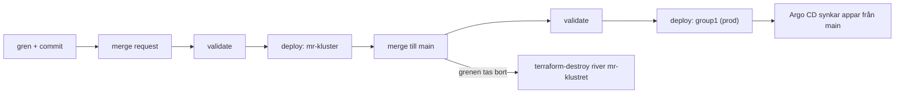

# CI med GitLab

All automatik ligger i `.gitlab-ci.yml`. Pipelinen bygger kluster, uppdaterar
prod och sparar sealed-secrets-nycklarna varje dag. Den här texten förklarar
vad som körs när, och varför. Variablerna står i [README](../../README.md),
avsnittet *CI-variabler*.

## Vilken pipeline blir det?

Överst i filen ligger `workflow: rules`. De bestämmer vilken miljö pipelinen
gäller, genom två variabler som jobben sedan läser:

- `VERSION` är klustrets namn och Terraform-statens namn.
- `DEPLOY` säger om kluster ska byggas eller uppdateras.

Reglerna testas uppifrån och ner, och **den första som matchar vinner**.
`CI_PIPELINE_SOURCE` är en inbyggd GitLab-variabel som säger vad som startade
pipelinen (`push`, `merge_request_event`, `schedule` med flera). Alla inbyggda
variabler finns i GitLabs dokumentation, sök på *predefined variables*.

| # | När | `VERSION` | `DEPLOY` | Vad som händer |
|---|---|---|---|---|
| 1 | schemat (`schedule`) | `group1` | `false` | backup av sealed-secrets-nycklarna, inget kluster rörs |
| 2 | push eller merge till `main` | `group1` | `true` | prod uppdateras |
| 3 | en merge request | `mr` plus MR-numret | `true` | ett eget kluster byggs för MR:en |
| 4 | allt annat, t.ex. push till en gren utan MR | ej satt | `false` | inga deploy- eller valideringsjobb |

Regel 2 har tre villkor med `&&`, alla måste stämma: grenen är `main`, och
pipelinen är varken en MR eller schemat. De två sista finns för att en MR-
eller schemapipeline aldrig ska råka bli en prod-deploy.

## Stages och jobb

Stages körs i ordning: `prepare`, `validate`, `deploy`, `maintenance`,
`cleanup`. Med `needs` kan ett jobb starta så fort jobben det beror på är
klara, utan att vänta på hela stagen.

| Stage | Jobb | Körs när | Vad det gör |
|---|---|---|---|
| prepare | `build-util-image` | `group1` och `ci/util.Dockerfile` eller `.gitlab-ci.yml` ändrad | bygger util-imagen (terraform, ansible, helm, kubectl) med buildkit och pushar den till GitLabs registry |
| validate | `terraform-validate` | `DEPLOY=true` | `terraform validate` i `terraform/` |
| validate | `helm-lint` | `DEPLOY=true` | `helm lint` på alla charts, app of apps och secrets, plus `helm template` |
| validate | `terraform-validate-dns` | `group1` och `dns/` eller `.gitlab-ci.yml` ändrad | `terraform validate` i `dns/` |
| deploy | `terraform-deploy` | `DEPLOY=true`, efter båda valideringarna | `terraform apply` mot staten `VERSION` |
| deploy | `terraform-deploy-dns` | som `terraform-validate-dns` | `terraform apply` mot staten `dns` |
| deploy | `ansible-deploy` | `DEPLOY=true`, efter `terraform-deploy` | `ansible-playbook site.yml -e cluster=$VERSION` |
| maintenance | `put-sealed-secrets` | bara schemat | hämtar nycklarna ur klustret, krypterar och committar dem till grenen `secrets` |
| cleanup | `terraform-destroy` | MR-kluster, manuellt | `terraform destroy` och raderar staten |

Det finns inget eget `terraform plan`-jobb. `terraform-deploy` kör
`apply -auto-approve` direkt. Skyddet före merge är valideringen och att
MR:en bygger ett eget kluster först.

## Mallarna

Jobben ärver gemensamma delar med `extends` från tre mallar. De börjar med
punkt, så GitLab kör dem inte som egna jobb.

- `.terraform`: util-imagen, `cd` till `DIR` och `terraform init` mot GitLabs
  HTTP-backend. Staten heter `STATE_URL/VERSION` och låses under körningen.
  CI loggar in med jobbets egen token (`CI_JOB_TOKEN`), ingen personlig.
  Här sätts också `admin_cidr` till `0.0.0.0/0`, motiveringen står i filen.
- `.ansible`: skriver vault-lösenordet och gruppens SSH-nyckel från
  CI-variablerna till filer i jobbet, så att Ansible kommer in på noderna.
- `.buildkit`: bygger images utan Docker-daemon (rootless buildkit) och
  loggar in i registryt med jobbets inbyggda variabler.

## Från MR till prod

1. MR:en startar regel 3. Terraform bygger `mr` plus numret med egen state,
   Ansible installerar k3s och Argo CD.
2. Vid merge startar regel 2 på `main`. Terraform och Ansible körs mot
   `group1`. Står allt redan rätt ändrar de ingenting.
3. När grenen tas bort vid merge stoppar GitLab miljön `review/mr...`, och
   det kör `terraform-destroy` (`on_stop`). Klustret rivs och staten raderas.
4. Apparna i klustret kommer inte från pipelinen utan från Argo CD, som läser
   `main`. Se [GitOps med Argo CD](../gitops/argo-cd.md).

## Bra att veta

- **En MR-pipeline stannar på status *manual*,** inte *success*, eftersom
  `terraform-destroy` väntar på en knapptryckning. Den blir grön först när
  klustret rivs.
- **Bara text i en MR:** skriv `[skip ci]` i den senaste commitens
  meddelande, så byggs inget mr-kluster i onödan.
- **Två pipelines mot samma state samtidigt** krockar på låset, och den ena
  failar. Merga inte medan en annan pipeline på `main` kör.
- **Taint på control planes bara i prod.** `ansible-deploy` sätter
  `k3s_taint_control_planes=true` på `main`, så att apparna hamnar på
  bare metal-workern. MR-kluster har ingen worker, där måste poddarna få köra
  på control planes.
- **Schemat kör mer än backupen.** I pipelines som inte startas av en push
  eller MR räknar GitLab `rules: changes` som sant. Därför kör schemat även
  `build-util-image` och DNS-jobben. DNS-applyn ändrar inget när posten
  redan stämmer.
- **Schemat** heter *Update sealed-secrets keys* och körs varje dag 14:11
  på `main` (*Build > Pipeline schedules*).

## Övningar

1. Du pushar en gren men öppnar ingen MR. Vilken regel matchar, och vad
   körs? *Regel 4. `DEPLOY` är `false`, så inga deploy- eller
   valideringsjobb körs och inget kluster byggs.*
2. Varför kan en MR aldrig råka uppdatera prod? *Regel 3 ger `VERSION=mr`
   plus numret, och Terraform använder `VERSION` som statens namn. MR:en
   rör bara sin egen state.*
3. Var ändrar du om valideringen ska köra `terraform fmt -check` också?
   *I `script` för `terraform-validate`.*
4. Hur vet ni att nyckelbackupen fungerar? *Jobbet `put-sealed-secrets` är
   grönt varje dag. När controllern har fått en ny nyckel committar
   Gitlab CI Bot en ny version till grenen `secrets`. Är nycklarna samma som
   förra gången skriver jobbet "has same keys" och committar inget.*
