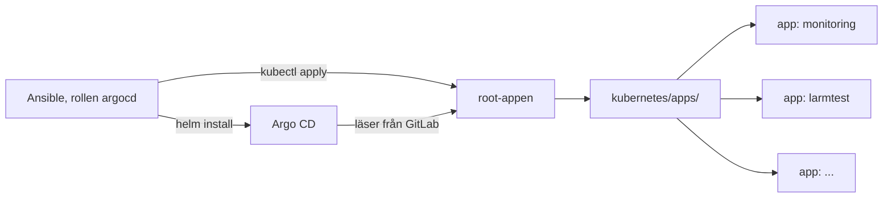

# GitOps med Argo CD

Efter bootstrap ändras klustret bara genom commits. Argo CD läser repot och
gör klustret likt det som står i git. Den här texten förklarar hur det
hänger ihop och varför. Kommandona står i [README](../../README.md),
avsnittet *GitOps*.

## Kedjan

1. Ansible installerar Argo CD med Helm och skapar root-appen. Det är det
   enda som görs utanför Argo.
2. Root-appen pekar på `kubernetes/apps/`, en liten Helm-chart.
3. Varje fil i `kubernetes/apps/templates/` är en Application. Den pekar
   antingen på en färdig chart med values från `kubernetes/values/`, eller
   på en mapp med egna manifest i `kubernetes/manifests/`.

| Mapp | Vad den innehåller |
|---|---|
| `kubernetes/apps/` | app of apps, en Application per fil i `templates/` |
| `kubernetes/values/` | values till färdiga charts, en fil per app |
| `kubernetes/manifests/` | egna manifest, en mapp per app |
| `ansible/roles/argocd/` | installerar Argo CD och skapar root-appen |

### Varför installeras Argo CD av Ansible?

Hönan och ägget: något måste finnas i klustret innan Argo kan synka resten.
Därför är Argo CD och root-appen det enda Ansible installerar. Allt annat
kommer från git.

## Dev-klustret följer din gren

Argo CD läser från GitLab, inte från din dator. Pekade allt på `main` skulle
ingen kunna testa en ändring förrän efter merge, och den som granskar en MR
skulle inte kunna se att den fungerar.

Därför får root-appen en gren, `argocd_revision`, och skickar den vidare
till alla appar som Helm-värdet `revision`. Varje fil i `templates/` använder
`{{ .Values.revision }}` i stället för att skriva `main`.

| Körning | Argo CD följer |
|---|---|
| prod, `-e cluster=group1` | `main` |
| dev, `-e cluster=anton` | `main` |
| dev, `-e cluster=anton -e argocd_revision=feature/monitoring` | `feature/monitoring` |

Argo CD ser bara det som är pushat. En commit som bara finns lokalt syns
inte i klustret.

## Inloggningen till repot

Repot är `internal`, så Argo CD måste logga in för att läsa det. Det gör
den med projektets deploy-token `argocd`, som bara får läsa
(`read_repository`) och går ut 2026-11-30. Värdena ligger i CI-variablerna
`ARGOCD_REPO_USER` och `ARGOCD_REPO_TOKEN`.

Ansible gör en Secret av dem och skickar den till klustret på stdin, så den
hamnar aldrig i git eller i en fil på noden. Argo CD hittar den på labeln
`argocd.argoproj.io/secret-type: repository`.

Developer-rollen kan inte läsa CI-variablerna. Skapa då en egen personal
access token med bara `read_repository` och lägg den i din `.envrc`.

## Begrepp att kunna

- **Application:** en app i Argo CD. Säger var i git den finns och vilket
  namespace den hamnar i.
- **App of apps:** en Application vars innehåll är andra Applications. Ny
  app = ny fil i `kubernetes/apps/templates/`.
- **Synced och Healthy:** Synced betyder att klustret är likt git. Healthy
  betyder att resurserna fungerar. De är oberoende: en app kan vara Synced
  men Degraded, om det som står i git är trasigt.
- **prune:** det som tas bort ur git tas bort ur klustret.
- **selfHeal:** en ändring för hand i klustret skrivs tillbaka till det som
  står i git.
- **Pull, inte push:** Argo CD hämtar från git. Efter bootstrap behöver CI
  inga rättigheter i klustret för att deploya.
- **Pinnade versioner:** Argo CD-chartens version står i
  `ansible/roles/argocd/defaults/main.yml`. Ett nybygge blir likadant som
  det förra.

## Övningar

Kör från repots rot med `KUBECONFIG` satt, se README.

1. **Se kedjan.** `kubectl -n argocd get applications`. Öppna UI:t och klicka
   på root-appen.
2. **Se en commit synkas.** Pusha en commit till din gren och jämför
   `git rev-parse HEAD` med
   `kubectl -n argocd get application root -o jsonpath='{.status.sync.revision}'`.
   Argo CD kollar git var tredje minut. *Refresh* i UI:t går fortare. Vad
   händer om du inte pushar?
3. **Bryt inloggningen.** `kubectl -n argocd delete secret grupprojekt-repo`,
   sen *Hard refresh*. Root-appen blir `Unknown` med `authentication
   required` under *Conditions*. Laga genom att köra playbooken igen.
4. **Kör playbooken två gånger.** Andra gången ska control planen ge
   `changed=0`. Varför installeras inte Argo CD om?

## Troliga frågor

- *Hur deployar ni en ny app?* En ny fil i `kubernetes/apps/templates/`, MR,
  merge. Argo CD synkar den inom tre minuter.
- *Någon ändrar något i klustret för hand. Vad händer?* selfHeal skriver
  tillbaka det som står i git.
- *Hur testar ni en ändring innan merge?* I ett eget dev-kluster som följer
  grenen, se ovan.
- *Varför ligger inte Argo CD:s UI publikt?* Exponera minimalt. Vi når det
  med port-forward, så ingen inloggningssida ligger ute på internet.
- *Vad händer om GitLab är nere?* Det som redan körs fortsätter köra. Bara
  synken stannar, tills GitLab är tillbaka.
- *Hur uppgraderar ni Argo CD?* Byt `argocd_chart_version` och kör
  playbooken. Rollen ser att versionen ändrats och kör `helm upgrade`.
