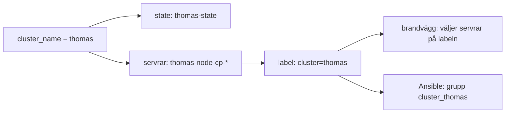

# En miljö per person

Var och en kan starta ett eget, fullständigt kluster att testa mot, utan att
röra någon annans eller prod. Den här texten förklarar hur det fungerar och
varför det är byggt så. Kommandona står i [README](../../README.md),
avsnitten *Terraform från din egen dator* och *Ansible*.

## Idén: ett namn genom hela kedjan

Allt hänger på ett namn per miljö: ditt eget för dev, `group1` för prod.
Samma namn används i varje lager:

| Lager | Var namnet syns | Exempel |
|---|---|---|
| Terraform-variabel | `cluster_name` | `thomas` |
| Terraform-state i GitLab | statens namn | `thomas-state` |
| Hetzner | servernamn och brandvägg | `thomas-node-cp-0`, `thomas-k3s-control-plane` |
| Hetzner | label på servrarna | `cluster=thomas` |
| Ansible | grupp i inventoryn | `cluster_thomas` |

Labeln är det som binder ihop Terraform och Ansible. Terraform sätter den,
och Ansible läser den direkt från Hetzners API. Ansible läser aldrig
Terraform-state.

## Terraform

### En state per person, inte en delad dev-state

Terraform-state är Terraforms bokföring över vad som finns. En `apply` gör
verkligheten lik koden, och tar bort det som finns i staten men inte i koden.

Delar två personer en state och jobbar i olika grenar, river den enas
`apply` det som bara finns i den andras gren. Därför har var och en en egen
state. Den delade staten, `grupprojekt-terraform-state`, är prod och ändras
bara via merge request.

### Prefix, eftersom state inte skiljer resurser åt

State skiljer bara bokföringen åt, inte resurserna hos Hetzner. Hetzner
kräver unika servernamn per projekt, så två states med samma kod krockar.
Därför står `cluster_name` först i varje namn.

`cluster_name` har inget standardvärde. Glömmer du att sätta den stannar
Terraform och frågar, i stället för att skapa ett kluster med ett påhittat
namn.

### SSH-nyckeln läses, den skapas inte

Hetzner tillåter samma publika nyckel bara en gång per projekt. Skapade
varje state nyckeln som en resurs skulle den andra misslyckas, och en
`destroy` skulle ta bort nyckeln för alla.

Nyckeln `group1` är därför registrerad en gång, utanför Terraform, och
koden läser den med `data "hcloud_ssh_key"`. Ingen state äger den.

### Brandväggen väljer servrar på labeln

Varje kluster får en egen brandvägg som kopplas via
`label_selector = "role=control_plane,cluster=<namn>"`. Din brandvägg kan
alltså aldrig hamna på någon annans servrar, och din `admin_cidr` påverkar
bara ditt kluster.

### `setup.sh` byter state utan att kopiera

`setup.sh` kör `terraform init -reconfigure`, som bara byter vilken state
Terraform pekar på.

Tidigare körde den `-migrate-state`, som frågar om den aktiva staten ska
*kopieras* in i den nya. Svarade man ja vid byte från prod till sin egen
state följde prods servrar med, och en `destroy` i den egna staten hade
rivit prod.

## Ansible

### Inventoryn ser allas kluster

`ansible/inventory/group1.hcloud.yml` hämtar alla servrar som har labeln
`cluster`, oavsett värde, och skapar en grupp per kluster med `keyed_groups`:
`cluster_thomas`, `cluster_group1` och så vidare. Startar någon ett nytt
kluster dyker gruppen upp utan att filen ändras.

Rollgrupperna `cp_first` och `cp_rest` finns i varje kluster. `cp_first` är
noden som slutar på `-cp-0`, och `cp_rest` är övriga control planes.

### Bare metal-workern hör bara till prod

Workern i `worker.ini` är en fysisk server och kan bara ingå i ett kluster.
Den ligger därför i gruppen `cluster_group1` och kommer aldrig med i någons
dev-kluster.

### Därför `--limit`

En play riktar mot en roll, till exempel `hosts: cp_first`. Den rollen finns
i alla kluster samtidigt. `--limit cluster_<namn>` väljer vilket kluster, så
att samma playbook fungerar för alla miljöer.

| Körning | `hosts: cp_first` träffar |
|---|---|
| utan `--limit` | första noden i **alla** kluster, även prod |
| `--limit cluster_thomas` | bara `thomas-node-cp-0` |

Ett för snävt urval är ofarligt, eftersom Ansible hoppar över en play som
inte matchar några servrar. Det farliga är att glömma `--limit`.

## Kanske att fixa i framtiden

- **Skydd mot glömd `--limit`.** Ett alternativ är att låta playbooken kräva
  klustret som variabel, `hosts: "cluster_{{ cluster }}:&cp_first"` med
  `-e cluster=thomas`. Då avbryts körningen om variabeln saknas. Tas när
  första playbooken skrivs.
