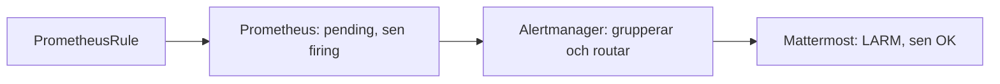

# Larm

Ett larm ska lösa ut, lämna klustret, nå Mattermost och clearas när
villkoret försvinner. Metrics och Prometheus beskrivs i
[monitoring.md](monitoring.md). Kommandona står i [README](../../README.md),
avsnittet *Larm*.

## Kedjan

1. **PrometheusRule** är larmregler: en PromQL-fråga, hur länge den ska
   vara sann (`for:`) och labels. Stacken har ett hundratal färdiga, t.ex.
   `TargetDown` och `KubePodCrashLooping`. Vår egen är `larmtest`.
2. **Prometheus** räknar på reglerna hela tiden. Blir frågan sann är larmet
   *pending*. Är den sann under hela `for:` blir det *firing* och skickas
   till Alertmanager.
3. **Alertmanager** samlar larm med samma `alertname` och `namespace`,
   väntar 30 sekunder (`group_wait`) och skickar dem enligt sina routes:

   | Larm | Går till |
   |---|---|
   | `Watchdog`, `InfoInhibitor` | ingenstans (`null`) |
   | `severity=info` | ingenstans |
   | allt annat | Mattermost |

4. **Mattermost** tar emot samma format som Slack, därför `slack_configs`.
   `send_resolved: true` gör att ett OK kommer när larmet clearas.

Rubriken blir `LARM [anton]: LarmtestAktiv` och sen `OK [anton]: ...`.
Namnet inom hakparentes är klustret, så det syns om larmet kommer från prod
eller från någons dev-kluster. Det kommer från labeln `cluster`, som
root-appen skickar in och Prometheus sätter på alla larm.

## Webhooken

Webhooken är en hemlighet: den som har den kan skriva i kanalen. Rollen
`app_secrets` gör Secreten `alertmanager-mattermost` av
`MATTERMOST_WEBHOOK_URL`. Alertmanager läser den från en fil
(`api_url_file`), så den syns aldrig i Alertmanagers konfiguration eller i
git.

## Hur lång tid tar det?

Uppmätt i dev 2026-10-10, från push till meddelande i Mattermost:

| Steg | Tid |
|---|---|
| Argo CD ser commiten | upp till 3 min, direkt med *Refresh* |
| podden startar, larmet blir pending | några sekunder |
| `for: 1m` | 1 min |
| `group_wait` i Alertmanager | 30 s |

Med *Refresh* tog det ungefär två minuter, åt båda hållen.

## Begrepp att kunna

- **expr, for, labels, annotations:** frågan, hur länge den ska vara sann,
  `severity` som styr vart larmet går, och texten i meddelandet.
- **pending, firing, resolved:** villkoret är sant men inte länge nog, sant
  länge nog, inte längre sant.
- **route, receiver, matchers:** routes matchar labels och väljer receiver.
  Den första route som matchar vinner.
- **group_wait, group_interval, repeat_interval:** vänta innan första
  meddelandet, vänta innan nya larm i samma grupp skickas, och skicka om
  ett larm som fortfarande brinner var fjärde timme.
- **Watchdog:** ett larm som alltid brinner, som bevis på att kedjan lever.
  Tystnar det har något gått sönder.

## Övningar

1. **Larmkedjan.** Sätt `replicas: 1` i
   `kubernetes/manifests/larmtest/deployment.yaml` och pusha till din gren.
   Följ larmet: appen i Argo CD, *Alerts* i Prometheus (pending, sen
   firing), Alertmanager och sist Mattermost. Sätt tillbaka `replicas: 0`
   och vänta på OK.
2. **selfHeal.** `kubectl -n larmtest scale deploy larmtest --replicas=2`.
   Argo CD sätter tillbaka 0 inom några sekunder. Varför löser larmet inte
   ut?
3. **Webhooken syns inte.** Öppna Alertmanager, *Status*. Konfigurationen
   visar `api_url_file`, inte adressen.
4. **Ändra regeln.** Byt `for: 1m` till `for: 2m` i
   `kubernetes/manifests/larmtest/prometheusrule.yaml`, pusha och gör
   övning 1 igen. Hur mycket längre tar det?
5. **Färdiga regler.** Hitta `TargetDown` och `KubePodCrashLooping` under
   *Alerts* i Prometheus. Vad skulle få dem att lösa ut?
6. **Gick det iväg?** Alertmanager räknar sina meddelanden:
   `curl -s localhost:9093/metrics | grep 'notifications.*slack'`. Totalen
   ska öka och felen stå kvar på 0.

## Troliga frågor

- *Hur vet du att larmet lämnar klustret?* Det syns i Mattermost, som
  ligger utanför klustret.
- *Hur clearas ett larm?* När frågan inte längre är sann blir larmet
  resolved, och `send_resolved: true` skickar ett OK.
- *Varför går Watchdog ingenstans?* Den brinner alltid med flit och skulle
  annars spamma kanalen.
- *Hur lägger någon till ett eget larm?* En PrometheusRule bredvid appen.
  Prometheus tar regler från alla namespaces.
- *Alertmanager når inte Mattermost. Hur märks det?*
  `alertmanager_notifications_failed_total` ökar och loggen visar felet.
  Alertmanager försöker igen.
- *Vad händer om Prometheus dör?* Då kommer inga larm alls, och Watchdog
  tystnar. Det fångar bara en extern vakt (dead man's switch) utanför
  klustret. Den har vi inte, men det är bra att kunna nämna.
