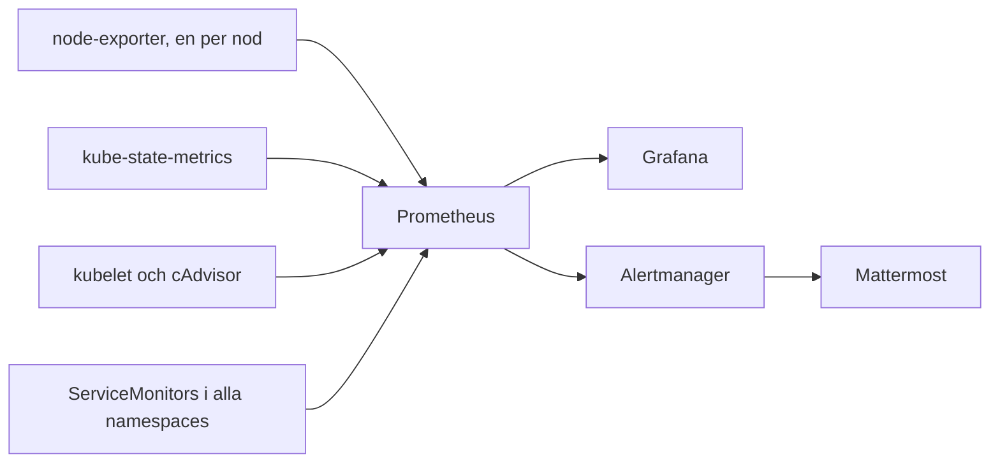

# Monitoring

kube-prometheus-stack ger metrics från både noderna och det som kör i
klustret, och dashboards i Grafana. Larmen beskrivs i [larm.md](larm.md).
Kommandona står i [README](../../README.md), avsnittet *Monitoring*.

## Vem skrapar vad

Prometheus hämtar (skrapar) metrics från olika källor var 30:e sekund och
sparar dem i 15 dagar. Grafana och Alertmanager läser från Prometheus.



| Källa | Ger | Exempel på metric |
|---|---|---|
| node-exporter | noderna: CPU, minne, disk, nätverk | `node_memory_MemAvailable_bytes` |
| kube-state-metrics | Kubernetes-objekt: poddar, deployments, repliker | `kube_deployment_status_replicas_available` |
| kubelet och cAdvisor | containrarnas CPU och minne | `container_memory_working_set_bytes` |
| ServiceMonitor | en apps egna metrics, t.ex. `/metrics` | beror på appen |

node-exporter ger *infrastrukturen*, de andra ger *workloads*. Uppgiften
kräver båda.

## Så kommer allas charts med

Stacken letar i alla namespaces, inte bara i sitt eget. Din egen chart
behöver alltså inte ändra något i monitoring. Testat i dev 2026-10-10.

**Metrics:** lägg en ServiceMonitor bredvid appen. Den säger åt Prometheus
att skrapa en Service på en viss port.

```yaml
apiVersion: monitoring.coreos.com/v1
kind: ServiceMonitor
metadata:
  name: min-app
  namespace: min-app
spec:
  selector:
    matchLabels:
      app: min-app     # samma labels som din Service
  endpoints:
    - port: metrics    # portens namn i din Service
```

**Dashboard:** lägg dashboardens JSON i en ConfigMap med labeln
`grafana_dashboard: "1"`. En sidecar i Grafana hittar den och laddar in den.

```yaml
apiVersion: v1
kind: ConfigMap
metadata:
  name: min-app-dashboard
  namespace: min-app
  labels:
    grafana_dashboard: "1"
data:
  min-app.json: |
    { "title": "Min app", "panels": [] }
```

**Larmregler:** en PrometheusRule, se [larm.md](larm.md).

Det som gör det möjligt är `serviceMonitorSelectorNilUsesHelmValues: false`
(och motsvarande för PodMonitors, regler och probes) i
`kubernetes/values/monitoring.yaml`, plus `searchNamespace: ALL` för
dashboards.

## Det som är anpassat för oss

- **Controller-manager, scheduler, proxy och etcd skrapas inte.** I k3s kör
  de inne i k3s-processen, inte som egna poddar. Stackens mål för dem skulle
  vara nere för evigt.
- **node-exporter tål alla taints**, annars hamnar den inte på control
  planes och vi får bara metrics från workern.
- **Port 9100 är öppen mellan noderna.** Prometheus kör på workern och
  skrapar control planes via deras publika IP. Utan regeln i
  `terraform/main.tf` larmade `TargetDown` för node-exporter.
- **Grafanas lösenord kommer från en Secret**, `grafana-admin`, som rollen
  `app_secrets` gör av `GRAFANA_ADMIN_PASSWORD`. Chartens eget slumpade
  lösenord fungerar inte med Argo CD, eftersom det slumpas om vid varje
  synk.

Grafana nås med port-forward tills wildcard-certifikatet finns. Sen får
den en ingress på HTTPS.

## Begrepp att kunna

- **Target och `up`:** varje sak Prometheus skrapar är ett target. `up` är 1
  om senaste skrapningen lyckades, annars 0.
- **Exporter:** ett program som gör om något till metrics, t.ex.
  node-exporter för Linux.
- **ServiceMonitor:** säger åt Prometheus vad som ska skrapas. Operatorn gör
  om den till Prometheus-konfiguration.
- **PromQL:** frågespråket. `rate()` ger ökning per sekund för en räknare,
  `sum by (namespace)` summerar per namespace.
- **Retention:** hur länge metrics sparas, 15 dagar på en PVC på 20 GB.

## Övningar

1. **Alla targets uppe?** Öppna Prometheus, *Status > Targets*. Frågan
   `up == 0` ska inte ge något.
2. **Några frågor i PromQL**, under *Graph*:
   - `100 * (1 - node_memory_MemAvailable_bytes / node_memory_MemTotal_bytes)`, använt minne per nod i procent
   - `sum by (namespace) (rate(container_cpu_usage_seconds_total[5m]))`, CPU per namespace
   - `kube_deployment_status_replicas_available`, repliker per deployment
3. **Dashboards.** Öppna Grafana och titta på *Node Exporter / Nodes* och
   *Kubernetes / Compute Resources / Namespace (Pods)*. Vilken nod kör
   mest?
4. **Bryt ett target.** Ta bort regeln för 9100 i `terraform/main.tf`,
   lokalt utan att committa, och kör `terraform apply` mot din egen state. Se `up` bli 0 för control
   planens node-exporter och `TargetDown` gå till *pending* under *Alerts*.
   Lägg tillbaka regeln.
5. **En egen app i monitoring.** Lägg exemplen ovan i ett eget namespace
   med `kubectl apply`. Se ditt target i Prometheus och din dashboard i
   Grafana. Ta bort dem igen. På riktigt går det via git.
6. **Ändra via git.** Byt `retention: 15d` till `10d` i
   `kubernetes/values/monitoring.yaml`, pusha till din gren och se appen
   `monitoring` synkas. Kontrollera med
   `kubectl -n monitoring get prometheus -o jsonpath='{.items[0].spec.retention}'`.

## Troliga frågor

- *Hur kommer en ny app in i monitoring?* En ServiceMonitor och en
  dashboard-ConfigMap bredvid appen. Ingen ändring i stacken.
- *Hur får ni metrics från både infrastruktur och workloads?*
  node-exporter för noderna, kube-state-metrics, cAdvisor och
  ServiceMonitors för det som kör i klustret.
- *Varför är kubeScheduler avstängd?* Den finns inte som egen pod i k3s.
- *Var sparas metrics?* På en PVC på noden där Prometheus kör, i 15 dagar.
  Byggs klustret om försvinner de.
- *Ett target är nere. Hur felsöker du?* *Status > Targets* visar felet.
  Ofta är det en brandvägg, som med port 9100.
