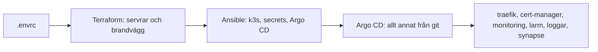

# Steg för steg: bygg hela klustret själv

Den här guiden bygger ett eget kluster från noll, i samma ordning som
pipelinen ska göra det i prod. Målet är att förstå vad vi har byggt: varje
steg säger vad som händer, var koden ligger och hur du ser att det
fungerade. Då kan du ändra i vilken del som helst och veta vad det påverkar.

Gå igenom guiden från början till slut minst en gång. På labben lottas
delarna och ändringar görs via commit, så alla behöver ha sett hela kedjan.

Varför sakerna är byggda som de är står i README och i `docs/`. Guiden
länkar dit i stället för att upprepa det.

## Läget per 2026-10-19

*Klart* betyder byggt och testat i ett dev-kluster. Prod byggs av
pipelinen vid varje merge till `main` sedan 2026-10-19. Att titta på och
felsöka prod: [drift.md](drift.md). Uppdatera tabellen i samma MR som en
del blir klar.

| Del | Läge | Var i repot | Steg |
|---|---|---|---|
| Kluster: control planes och en worker | klart i dev med en worker-VM. Bare metal-workern är inte ansluten än, det görs i prod | `terraform/`, `ansible/` | 3, 4 |
| Krypterad trafik mellan noderna | klart, WireGuard i k3s | `ansible/roles/k3s_server/` | 4 |
| DNS: wildcard mot workern | klart | `dns/` | gemensam, rörs inte här |
| Certifikat och HTTPS | klart: cert-manager hämtar ett wildcard-cert med DNS-01 (staging i dev, riktigt bara i prod). Traefik är en egen Argo-app och skickar HTTP vidare till HTTPS | `kubernetes/apps/templates/traefik.yaml`, `kubernetes/apps/templates/cert-manager*.yaml`, `kubernetes/manifests/cert-manager-issuers/` | 5, 6 |
| Continuous deployment | klart, Argo CD | `kubernetes/apps/` | 4, 7 |
| Monitoring | klart. Grafanas ingress på HTTPS är byggd men inte testad i dev | `kubernetes/values/monitoring.yaml` | 6 |
| Larm | klart | `kubernetes/values/monitoring.yaml`, `kubernetes/manifests/larmtest/` | 7 |
| Loggar | klart: Loki och Alloy, poddloggar och journald från alla noder | `kubernetes/values/loki.yaml`, `kubernetes/values/alloy.yaml`, `docs/loggar/` | 5, 6 |
| Secrets | delvis: CI-variabler som Ansible gör till Secrets, Sealed Secrets planerat | `ansible/roles/app_secrets/` | 2, 4 |
| Pipeline | klart: bygger prod från `main` | `.gitlab-ci.yml` | se *Från dev till prod* |
| Synapse, individuell del | klart | `charts/synapse/` | 6 |
| Ghost, individuell del | i prod, men kraschar per 2026-10-19 (se [drift.md](drift.md), *Felsökning*) | `charts/ghost/` | 5, 6 |

## Översikt



| Steg | Verktyg | Vad som händer | I prod, när pipelinen finns |
|---|---|---|---|
| 0-2 | du | verktyg, hemligheter och `.envrc` | CI-variablerna |
| 3 | Terraform | VM:ar och brandvägg med ditt namn | samma kod, `cluster_name = group1` |
| 4 | Ansible | användare, k3s, secrets och Argo CD | samma playbook, `-e cluster=group1` |
| 5-6 | kubectl | kolla att allt kom upp | samma |
| 7 | git | ändra klustret med en commit | samma, via MR till `main` |
| 8 | Terraform | riv | prod rivs bara vid genrepet |

Står inget annat börjar kodblocken i repots rot.

## Steg 0: verktyg

| Verktyg | Används i |
|---|---|
| `terraform` eller `tofu` | steg 3 och 8. Med tofu byter du `terraform` mot `tofu` i kommandona |
| `ansible-core` 2.18 eller nyare | steg 4. Collectionerna kräver det, och apt i Ubuntu 24.04 har en för gammal |
| `kubectl` | steg 5 till 7 |
| `direnv` | laddar `.envrc`, valfritt. Kräver hooken i ditt skal, se direnv.net |
| `git`, `openssl`, `curl`, `jq` | små saker längs vägen |

Installera Ansible med pipx. Inventoryn (collectionen `hetzner.hcloud`)
behöver också Python-paketen `requests` och `python-dateutil`, i samma
Python som Ansible:

```bash
pipx install ansible-core
pipx inject ansible-core requests python-dateutil
```

Har du redan Ansible via pipx som paketet `ansible`, byt `ansible-core` mot
`ansible` på andra raden.

Kontrollera:

```bash
terraform version
ansible --version
kubectl version --client
```

`ansible --version` ska visa core 2.18 eller nyare.

Klona repot om du inte redan har det, på samma sätt som du brukar pusha
(SSH, eller HTTPS med en token som får skriva). Steg 7 pushar en gren.

```bash
git clone git@git.chas-lab.dev:devops-grupp-1/grupprojekt.git
cd grupprojekt
```

Har du redan repot, hämta senaste `main`. Terraform och Ansible kör din
lokala kod, Argo CD läser från GitLab, så de ska vara samma:

```bash
git switch main
git pull
```

## Steg 1: hemligheterna

Inga hemligheter i git och inga i klartext i en kanal. Behöver någon ett
värde skickas det med en engångslänk.

| Det du behöver | Maintainer | Developer |
|---|---|---|
| `HCLOUD_TOKEN` | CI-variabeln, *Settings > CI/CD > Variables* | engångslänk från en Maintainer |
| gruppens privata SSH-nyckel | CI-variabeln `GROUP1_SSH_KEY` | engångslänk |
| `MATTERMOST_WEBHOOK_URL` | CI-variabeln | engångslänk |
| `ARGOCD_REPO_USER` och `ARGOCD_REPO_TOKEN` | CI-variablerna | egen personal access token med bara `read_repository`, ditt GitLab-namn som user |
| `GITLAB_ACCESS_TOKEN` | egen personal access token med scope `api` | behövs inte, du kör lokal state i steg 3 |

Personal access token skapar du under avataren > *Edit profile* > *Access
tokens*. Den visas bara en gång. Resten av värdena skapar du själv i steg 2.

Developer kan varken se CI-variablerna eller skriva Terraform-state i
GitLab. Därför ser steg 3 lite annorlunda ut för dig.

### SSH-nyckeln

Spara nyckeln som `~/.ssh/group1_hetzner`, där letar `ansible/ansible.cfg`.
Klistra in den i din editor, inte med `echo`, så hamnar den inte i
skalhistoriken. Filen måste sluta med en radbrytning, annars säger ssh
`invalid format`.

```bash
chmod 600 ~/.ssh/group1_hetzner
ssh-keygen -y -f ~/.ssh/group1_hetzner
```

Den andra raden räknar fram den publika nyckeln. Den ska sluta på
`group1-hetzner-lab` och vara samma som `group1_ssh_public_key` i
`ansible/group_vars/all.yml`. Ansible lägger in just den på användaren
`group1` på varje maskin, så att läraren alltid kommer in.

## Steg 2: `.envrc`

Alla värden ligger i en enda fil: `.envrc` i repots rot. Den är
gitignorerad och laddas av direnv när du går in i repot, även i `ansible/`
och `terraform/`. Lägg den aldrig i en undermapp. direnv läser bara den
närmaste filen, så en `.envrc` i `ansible/` gör att den i roten inte läses
alls.

Skapa filen i din editor med det här innehållet och fyll i värdena från
steg 1:

```bash
# Hetzner och GitLab
export HCLOUD_TOKEN=...
export GITLAB_ACCESS_TOKEN=...
export GITLAB_USER_NAME=...

# Ditt kluster
export TF_VAR_cluster_name=...
export TF_VAR_admin_cidr=...
export TF_VAR_control_plane_count=1
export TF_VAR_worker_count=1

# Apparna
export ARGOCD_REPO_USER=...
export ARGOCD_REPO_TOKEN=...
export MATTERMOST_WEBHOOK_URL=...
export TF_VAR_tsig_secret=...
```

| Variabel | Värde |
|---|---|
| `GITLAB_USER_NAME` | ditt användarnamn i GitLab. Developer tar bort den raden och `GITLAB_ACCESS_TOKEN` |
| `TF_VAR_cluster_name` | ditt förnamn, bara a-z, 0-9 och bindestreck (inga å, ä, ö). Prefix på allt du skapar. Aldrig `group1`, det är prod |
| `TF_VAR_admin_cidr` | din publika IPv4 plus `/32`. `curl -4 -s https://ifconfig.me` visar den. Utan `-4` kan du få IPv6, som inte fungerar här. Den enda adress som når port 6443 på ditt kluster |
| `TF_VAR_control_plane_count` | `1` räcker i dev och är billigare. Prod har 3 |
| `TF_VAR_worker_count` | `1` ger en worker-VM, så att ditt kluster ser ut som prod |
| `TF_VAR_tsig_secret` | TSIG-nyckeln, värdet finns i CI-variabeln med samma namn. Behövs av `app_secrets` så att cert-manager kan skriva TXT-poster för DNS-01 |

Byter du nätverk, till exempel mellan skolan och hemma, ändra `admin_cidr`
och kör `terraform apply` igen. Annars når du inte ditt kluster med
`kubectl`.

Sedan värdena du skapar själv, från repots rot. Varje rad lägger bara till
ett värde som inte redan finns, så blocket går att köra igen:

```bash
grep -q '^export K3S_TOKEN=' .envrc || echo "export K3S_TOKEN=$(openssl rand -hex 32)" >> .envrc
grep -q '^export GRAFANA_ADMIN_PASSWORD=' .envrc || echo "export GRAFANA_ADMIN_PASSWORD=$(openssl rand -hex 16)" >> .envrc
grep -q '^export SYNAPSE_POSTGRES_PASSWORD=' .envrc || echo "export SYNAPSE_POSTGRES_PASSWORD=$(openssl rand -hex 16)" >> .envrc
grep -q '^export SYNAPSE_REGISTRATION_SHARED_SECRET=' .envrc || echo "export SYNAPSE_REGISTRATION_SHARED_SECRET=$(openssl rand -hex 32)" >> .envrc
grep -q '^export GHOST_MYSQL_ROOT_PASSWORD=' .envrc || echo "export GHOST_MYSQL_ROOT_PASSWORD=$(openssl rand -hex 16)" >> .envrc
grep -q '^export GHOST_MYSQL_PASSWORD=' .envrc || echo "export GHOST_MYSQL_PASSWORD=$(openssl rand -hex 16)" >> .envrc
grep -q '^export GHOST_MYSQL_EXPORTER_PASSWORD=' .envrc || echo "export GHOST_MYSQL_EXPORTER_PASSWORD=$(openssl rand -hex 16)" >> .envrc
chmod 600 .envrc
direnv allow
```

Byt aldrig de här värdena på ett kluster som redan finns. En ny `K3S_TOKEN`
gör att noderna inte kan ansluta, och ett nytt databaslösenord gör att
Synapse (Postgres) eller Ghost (MySQL) inte kommer in i sin databas,
eftersom lösenorden bara sätts när databasen skapas. Behöver du nya värden, riv klustret först. Ditt kluster
har sina egna värden, prods ligger i CI-variablerna.

Utan direnv: hoppa över `direnv allow` och kör `source .envrc` från repots
rot i varje ny terminal.
Skriv aldrig `export` med ett hemligt värde direkt i terminalen, det hamnar
i skalhistoriken.

Kontrollera att allt är satt, utan att skriva ut värdena:

```bash
for v in HCLOUD_TOKEN GITLAB_ACCESS_TOKEN GITLAB_USER_NAME \
  TF_VAR_cluster_name TF_VAR_admin_cidr K3S_TOKEN \
  ARGOCD_REPO_USER ARGOCD_REPO_TOKEN MATTERMOST_WEBHOOK_URL TF_VAR_tsig_secret \
  GRAFANA_ADMIN_PASSWORD SYNAPSE_POSTGRES_PASSWORD SYNAPSE_REGISTRATION_SHARED_SECRET \
  GHOST_MYSQL_ROOT_PASSWORD GHOST_MYSQL_PASSWORD GHOST_MYSQL_EXPORTER_PASSWORD; do
  val=$(printenv "$v")
  if [ -n "$val" ] && [ "$val" != "..." ]; then echo "ok      $v"; else echo "SAKNAS  $v"; fi
done
unset val
```

`SAKNAS` betyder att variabeln inte är satt, är tom eller fortfarande har
`...` från mallen. Som Developer blir de två `GITLAB_`-raderna `SAKNAS`, det
är väntat.

Developer som inte har fått `TF_VAR_tsig_secret`: ett påhittat värde tar
dig förbi kontrollen i `app_secrets`, och allt utom certet kommer upp. Utan
den riktiga nyckeln får cert-manager inte skriva i DNS, så certet blir
aldrig klart.

Gå in i `ansible/` och kör loopen igen. Svaret ska bli detsamma. Blir
nästan allt `SAKNAS` där men inte i roten har du en gammal `ansible/.envrc`
från när README sa fel. Flytta raderna till rotens `.envrc`, ta bort
`ansible/.envrc` och kör `direnv allow` i roten. Finns `K3S_TOKEN` på båda
ställena, behåll den som ditt kluster byggdes med, eller riv klustret och
börja om.

## Steg 3: Terraform, servrarna

Terraform skapar VM:arna och en brandvägg för control planes. Allt får ditt
namn först och labeln `cluster` med ditt namn som värde. Labeln är det
Ansible hittar servrarna med i steg 4. Varför det är byggt så:
[miljo-per-person.md](miljoer/miljo-per-person.md).

| Fil | Vad den gör |
|---|---|
| `terraform/main.tf` | servrarna, worker-VM:en för dev och brandväggen |
| `terraform/variables.tf` | variablerna som `TF_VAR_` i din `.envrc` sätter |
| `terraform/setup.sh` | pekar Terraform mot din state i GitLab |

**Maintainer**, state i GitLab:

```bash
cd terraform
./setup.sh "$TF_VAR_cluster_name-state"
terraform plan
```

Vilken state du står på, om du är osäker. Från `terraform/`:

```bash
grep -o 'terraform/state/[^"/]*' .terraform/terraform.tfstate | head -1
```

**Developer**, lokal state. Filen `backend_override.tf` byter ut
`backend "http"` i `main.tf` och är gitignorerad:

```bash
cd terraform
printf 'terraform {\n  backend "local" {}\n}\n' > backend_override.tf
terraform init -reconfigure
terraform plan
```

Staten hamnar i `terraform/terraform.tfstate` på din dator. Ta inte bort
den medan servrarna finns, utan den kan Terraform inte riva dem.

**Läs planen innan du går vidare.** Med en control plane och en worker ska
den sluta med `Plan: 3 to add, 0 to change, 0 to destroy`, och alla tre har
ditt namn: `...-node-cp-0`, `...-node-worker-0` och brandväggen
`...-k3s-control-plane`. Visar den `-` eller `~` på något som inte heter
ditt namn står du på fel state: kör inte `apply`.

Fortfarande i `terraform/`:

```bash
terraform apply
cd ..
```

`apply` visar planen igen och frågar. Svara `yes`. Efter någon minut
skriver den ut `cp_ips`, control planens adress.

## Steg 4: Ansible, k3s, secrets och Argo CD

`site.yml` gör resten av bootstrap. Det är fem plays som körs i ordning:

| Play | Körs på | Gör | Koden |
|---|---|---|---|
| 1 | alla noder | användaren `group1` med gruppnyckeln och sudo, som spelreglerna kräver | `ansible/site.yml` |
| 2 | första control planen | k3s med inbyggd etcd (`--cluster-init`) och WireGuard mellan noderna, hämtar kubeconfig | `ansible/roles/k3s_server/` |
| 3 | övriga control planes, en i taget | ansluter till den första. Inga i dev med en control plane | `ansible/roles/k3s_server/` |
| 4 | workers | ufw först, sedan k3s som agent | `ansible/roles/k3s_agent/` |
| 5 | första control planen | Kubernetes-Secrets av din `.envrc`, Argo CD och root-appen | `ansible/roles/app_secrets/`, `ansible/roles/argocd/` |

Efter play 5 tar Argo CD över, och allt annat kommer från git. Ansible
körs alltid från `ansible/`, annars läses inte `ansible.cfg`.

`ansible.cfg` säger att lösenordet till ansible-vault ligger i
`ansible/.vault_pass`, och utan den filen stannar varje körning. Bara
runnerns variabler (`group_vars/runners.yml`) är krypterade, så `site.yml`
behöver inte det riktiga lösenordet, bara att filen finns. Filen är
gitignorerad, och raden skriver inte över en fil som redan finns:

```bash
cd ansible
[ -f .vault_pass ] || echo dummy > .vault_pass
ansible-galaxy collection install -r requirements.yml -p collections --force
ansible-playbook site.yml -e cluster="$TF_VAR_cluster_name" --list-hosts
cd ..
```

`--list-hosts` kör ingenting, den visar bara vilka servrar varje play
träffar. Det ska bara vara dina, `...-node-cp-0` och `...-node-worker-0`.
Står `worker` (bare metal-workern i prod) eller någon annans namn där:
stanna.

Sedan på riktigt. `k3s_taint_control_planes=true` sätter `NoSchedule` på
control planen som i prod, så att apparna bara hamnar på workern:

```bash
cd ansible
ansible-playbook site.yml -e cluster="$TF_VAR_cluster_name" -e k3s_taint_control_planes=true
cd ..
```

Det tar runt fem minuter. `PLAY RECAP` sist ska visa `failed=0` för alla
servrar. Playbooken skriver kubeconfig till `$TF_VAR_cluster_name.kubeconfig`
i repots rot, gitignorerad.

Kör samma kommando en gång till. Nu ska control planen ge `changed=0`,
eftersom rollerna bara gör något när det behövs. Varför installeras inte
Argo CD om?

| Felet | Orsak |
|---|---|
| `The vault password file ... was not found` | `.vault_pass` saknas i `ansible/`, se början av steg 4 |
| `'cluster' is undefined` | `-e cluster=...` saknas. Skyddet är med flit, se README |
| `... saknas i miljön` | en variabel saknas, kör kontrollen i steg 2 |
| `hosts (0)` i `--list-hosts` | `.envrc` är inte laddad i `ansible/`, eller servrarna finns inte. Kör kontrollen i steg 2 från `ansible/` |
| fel om `requests` eller `dateutil` | Python-paketen i steg 0 |
| `Permission denied (publickey)` | nyckeln, se steg 1 |
| timeout i första tasken | servrarna har precis startat, kör igen |

## Steg 5: kolla klustret

```bash
export KUBECONFIG=$PWD/$TF_VAR_cluster_name.kubeconfig
kubectl get nodes
kubectl get nodes -o 'custom-columns=NOD:.metadata.name,TAINT:.spec.taints[*].effect'
```

Båda noderna ska vara `Ready`. Control planen har `NoSchedule`, workern
`<none>`. Hänger `kubectl` tills den får timeout stämmer inte `admin_cidr`
med din IPv4. Rätta den i `.envrc` och kör `terraform apply` i `terraform/`
igen.

```bash
kubectl get pods -A -o wide
```

Titta i kolumnen `NODE`: apparna ligger på workern. På control planen finns
bara det som tål taint, som k3s egna poddar, node-exporter och Alloy.

```bash
kubectl -n argocd get applications
```

Efter några minuter ska alla vara `Synced` och `Healthy`: `root`,
`traefik`, `cert-manager`, `cert-manager-issuers`, `monitoring`,
`larmtest`, `loki`, `alloy`, `loggar`, `synapse` och `ghost`. Första
gången tar det längre, när alla images laddas ner, och `Progressing` en
stund är normalt. Står en app kvar i `OutOfSync` eller
`Degraded`, öppna den i Argo CD:s UI (steg 6) och läs felet.

Certet:

```bash
kubectl -n traefik get certificate
```

`wildcard-group-1` ska bli `READY True` inom några minuter. cert-manager
bevisar för Let's Encrypt att vi äger domänen genom att skriva en TXT-post
i DNS (DNS-01), därför behövs TSIG-nyckeln. Ditt kluster får ett cert från
Let's Encrypts staging, bara `group1` får ett riktigt. Certet ligger i
namespacet `traefik`, eftersom Traefik bara läser certet från sitt eget
namespace. Fastnar det på `False`, läs varför med `kubectl -n traefik
describe certificate wildcard-group-1` och följ kedjan nedåt med
`kubectl get certificaterequest,order,challenge -A`.

Använder du direnv kan du lägga `KUBECONFIG`-raden sist i `.envrc`, så
slipper du skriva den i varje terminal. direnv läser filen från roten, så
`$PWD` blir rätt.

## Steg 6: titta in i apparna

Hostnamnen i `kubernetes/values/` pekar på prods worker via wildcard-posten,
så i dev når du apparna med port-forward. Varje port-forward tar en
terminal, avsluta med Ctrl-C. Med `KUBECONFIG` satt som i steg 5:

| App | Kommando | Adress | Inloggning |
|---|---|---|---|
| Argo CD | `kubectl -n argocd port-forward svc/argocd-server 8080:80` | http://localhost:8080 | `admin`, lösenordet nedan |
| Grafana | `kubectl -n monitoring port-forward svc/monitoring-grafana 3000:80` | http://localhost:3000 | `admin` och `GRAFANA_ADMIN_PASSWORD` |
| Prometheus | `kubectl -n monitoring port-forward svc/monitoring-kube-prometheus-prometheus 9090:9090` | http://localhost:9090 | ingen |
| Alertmanager | `kubectl -n monitoring port-forward svc/monitoring-kube-prometheus-alertmanager 9093:9093` | http://localhost:9093 | ingen |
| Synapse | `kubectl -n synapse port-forward svc/synapse 8008:8008` | http://localhost:8008 | användare, se nedan |

Argo CD:s lösenord:

```bash
kubectl -n argocd get secret argocd-initial-admin-secret -o jsonpath='{.data.password}' | base64 -d; echo
```

### HTTPS i ditt kluster

I prod nås Grafana på https://grafana.group-1.doe25.chas-lab.dev, Synapse
på https://matrix.group-1.doe25.chas-lab.dev och Ghost på
https://ghost.group-1.doe25.chas-lab.dev. Ditt kluster har
samma ingresser, men DNS pekar på prod. `curl --resolve` låter dig välja
adressen själv och skicka samma hostnamn till din worker:

```bash
WORKER_IP=$(kubectl get node "$TF_VAR_cluster_name-node-worker-0" -o jsonpath='{.status.addresses[?(@.type=="InternalIP")].address}')
GRAFANA_HOST=grafana.group-1.doe25.chas-lab.dev
curl -s -o /dev/null -w '%{http_code} %{redirect_url}\n' --resolve "$GRAFANA_HOST:80:$WORKER_IP" "http://$GRAFANA_HOST"
curl -sk -o /dev/null -w '%{http_code}\n' --resolve "$GRAFANA_HOST:443:$WORKER_IP" "https://$GRAFANA_HOST/login"
openssl s_client -connect "$WORKER_IP:443" -servername "$GRAFANA_HOST" </dev/null 2>/dev/null | openssl x509 -noout -subject -issuer
```

| Rad | Ska visa | Bevisar |
|---|---|---|
| första `curl` | `301` och en `https://`-adress | HTTP skickas vidare till HTTPS |
| andra `curl` | `200` | Ingressen hittar Grafana. `-k` för att dev-certet är från staging |
| `openssl` | subject `*.group-1.doe25.chas-lab.dev`, issuer med `STAGING` | Traefik använder wildcard-certet |

I prod är issuern Let's Encrypt utan `STAGING`, och då behövs inte `-k`.
Byt `GRAFANA_HOST` mot Ghosts host och testa den på samma sätt, med `/`
i stället för `/login`.
Hur Traefik och certet hänger ihop: README, avsnittet *Ingress och HTTPS*.
Hela vägen in till Grafana, och varför bara Grafana får en ingress:
[monitoring.md](monitoring/monitoring.md), avsnittet *Grafana på HTTPS*.

Det här ska du se, och kunna koppla till uppgiften:

- **Argo CD:** klicka på `root`. Alla appar hänger under den, det är app of
  apps.
- **Prometheus:** under *Status* finns sidan med targets. Allt ska vara up,
  även node-exporter på control planen (port 9100 i brandväggen).
- **Grafana:** under *Dashboards* finns både noderna (infrastruktur) och
  poddarna (workloads). Uppgiften kräver båda.
- **Loggar:** i Grafana under *Explore*, välj datasourcen `Loki`.
  `{namespace="synapse"}` ger Synapses poddloggar, `{job="journal"}`
  nodernas journald. Mer i [loggar.md](loggar/loggar.md).

**Synapse:** skapa en användare och prova API:t medan port-forwarden kör.
`-a` gör användaren till admin:

```bash
MATRIX_USER=$TF_VAR_cluster_name
kubectl -n synapse exec -it deploy/synapse -c synapse -- \
  register_new_matrix_user -c /config/homeserver.yaml -u "$MATRIX_USER" -a http://localhost:8008
curl -s localhost:8008/_matrix/client/versions
```

Fördjupning, med övningar och troliga frågor:
[argo-cd.md](gitops/argo-cd.md), [monitoring.md](monitoring/monitoring.md),
[larm.md](monitoring/larm.md) och
[charts/synapse/README.md](../charts/synapse/README.md).

## Steg 7: ändra klustret med en commit

Så här görs ändringar på labben: efter bootstrap ändras klustret bara
genom git. Argo CD läser från GitLab, inte från din dator, så ditt kluster
måste följa en gren som är pushad.

Skapa en övningsgren och låt klustret följa den. Playbooken ändrar bara
root-appen, resten finns redan:

```bash
MIN_GREN=ovning/$TF_VAR_cluster_name
git fetch origin
git switch -c "$MIN_GREN" origin/main
git push -u origin "$MIN_GREN"
cd ansible
ansible-playbook site.yml -e cluster="$TF_VAR_cluster_name" -e argocd_revision="$MIN_GREN"
cd ..
```

**Larmkedjan.** Ändra `replicas: 0` till `replicas: 1` i
`kubernetes/manifests/larmtest/deployment.yaml`, sedan:

```bash
git add kubernetes/manifests/larmtest/deployment.yaml
git commit -m "test(larm): larmtest på"
git push
```

Lägg bara till filen du ändrat. `git commit -a` kan få med
`terraform/.terraform.lock.hcl` om `init` har skrivit om den.

Följ vad som händer:

```bash
git rev-parse HEAD
kubectl -n argocd get application root -o jsonpath='{.status.sync.revision}'; echo
kubectl -n larmtest get pods -w
```

Argo CD kollar git var tredje minut. *Refresh* på appen i UI:t går
fortare. När revisionerna är lika startar podden, och efter en minut löser
`LarmtestAktiv` ut. I Mattermost kommer ett meddelande som börjar med
`LARM` och ditt klusternamn. Sätt tillbaka `replicas: 0`, commit och push:
larmet clearas och ett `OK` kommer. Ungefär två minuter åt varje håll.

**selfHeal.** Ändra något för hand:

```bash
kubectl -n larmtest scale deployment larmtest --replicas 3
kubectl -n larmtest get pods -w
```

Argo CD ser att klustret inte längre är likt git och skalar tillbaka. En
ändring för hand överlever inte, därför går allt via commit.

**Öva vidare** med låtsasförhöret i `charts/synapse/README.md`, till exempel
tre Element-poddar. Samma sätt varje gång: ändra filen, commit, push, se
Argo CD synka. Fundera på vad du förväntar dig innan du pushar.

Grenen ska inte mergas. Städa när du är klar:

```bash
MIN_GREN=ovning/$TF_VAR_cluster_name
git switch main
git push origin --delete "$MIN_GREN"
git branch -D "$MIN_GREN"
```

Nu följer klustret en gren som inte finns. Riv det i steg 8, eller kör
playbooken utan `argocd_revision` så följer det `main` igen.

## Steg 8: riv

Servrarna kostar per timme, och spelreglerna säger att labb-VM:ar rivs när
du är klar. Riv innan du slutar för dagen.

Kontrollera först vilken state du står på. Det ska vara din
(Developer har bara sin lokala och får inget svar här):

```bash
cd terraform
grep -o 'terraform/state/[^"/]*' .terraform/terraform.tfstate | head -1
cd ..
```

```bash
cd terraform
terraform destroy
cd ..
rm "$TF_VAR_cluster_name.kubeconfig"
```

Läs planen innan du svarar `yes`: varje resurs ska börja med ditt namn.
Står det `group1-` eller någon annans namn, svara nej.

Kontrollera att inga servrar finns kvar hos Hetzner. Svaret ska vara `0`.
Får du en text i stället är det ett fel från API:t, oftast att
`HCLOUD_TOKEN` inte är laddad:

```bash
curl -s -H "Authorization: Bearer $HCLOUD_TOKEN" \
  "https://api.hetzner.cloud/v1/servers?label_selector=cluster=$TF_VAR_cluster_name" \
  | jq 'if .servers then (.servers | length) else .error.message end'
```

Nästa gång börjar du på steg 3. `.envrc` och nyckeln finns kvar.

## Från dev till prod

Prod är samma kod med `cluster_name = group1` och `-e cluster=group1`, plus
det som bara finns där: tre control planes och bare metal-workern från
`ansible/inventory/worker.ini`. Pipelinen gör steg 3 och 4 med
CI-variablerna i stället för din `.envrc`, vid varje merge till `main`.
Steg 5 till 7 är desamma, se [drift.md](drift.md).

| Jobb | Gör | Motsvarar |
|---|---|---|
| `build-util-image` | bygger imagen med Terraform, Ansible och verktygen, bara när `ci/util.Dockerfile` eller `.gitlab-ci.yml` ändras | steg 0 |
| `terraform-validate` | kontrollerar Terraform-koden | |
| `terraform-deploy` | `terraform apply` mot staten `group1` | steg 3 |
| `ansible-deploy` | `site.yml -e cluster=group1` med taint på control planes | steg 4 |
| `terraform-destroy` | manuell, finns inte för `group1` | steg 8 |

Varje MR bygger ett eget kluster, `mr` plus MR-numret, som rivs med
`terraform-destroy` (för hand, eller av GitLab när grenen tas bort vid
merge). Ändrar MR:en bara text, skriv `[skip ci]` i den senaste commitens
meddelande. Kör aldrig steg 3 eller 4 mot prod från din dator, se *Regler*
i README.

## När en del blir klar

Lägg till ett steg, eller en rad i steg 6, och uppdatera tabellen överst i
samma MR. Sealed Secrets saknas per 2026-10-19.
