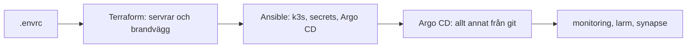

# Steg för steg: bygg hela klustret själv

Den här guiden bygger ett eget kluster från noll, i samma ordning som
pipelinen ska göra det i prod. Målet är att förstå vad vi har byggt: varje
steg säger vad som händer, var koden ligger och hur du ser att det
fungerade. Då kan du ändra i vilken del som helst och veta vad det påverkar.

Gå igenom guiden från början till slut minst en gång. På labben lottas
delarna och ändringar görs via commit, så alla behöver ha sett hela kedjan.

Varför sakerna är byggda som de är står i README och i `docs/`. Guiden
länkar dit i stället för att upprepa det.

## Läget per 2026-10-11

*Klart* betyder byggt och testat i ett dev-kluster. Inget är byggt i prod
än, det väntar på pipelinen. Uppdatera tabellen i samma MR som en del blir
klar.

| Del | Läge | Var i repot | Steg |
|---|---|---|---|
| Kluster: control planes och en worker | klart | `terraform/`, `ansible/` | 3, 4 |
| Krypterad trafik mellan noderna | klart, WireGuard i k3s | `ansible/roles/k3s_server/` | 4 |
| DNS: wildcard mot workern | klart | `dns/` | gemensam, rörs inte här |
| Certifikat och HTTPS | saknas | | |
| Continuous deployment | klart, Argo CD | `kubernetes/apps/` | 4, 7 |
| Monitoring | klart | `kubernetes/values/monitoring.yaml` | 6 |
| Larm | klart | `kubernetes/values/monitoring.yaml`, `kubernetes/manifests/larmtest/` | 7 |
| Loggar | saknas | | |
| Secrets | delvis: CI-variabler som Ansible gör till Secrets, Sealed Secrets planerat | `ansible/roles/app_secrets/` | 2, 4 |
| Pipeline | saknas, ingen `.gitlab-ci.yml` | | |
| Synapse, individuell del | klart | `charts/synapse/` | 6 |

## Översikt



| Steg | Verktyg | Vad som händer | I prod, när pipelinen finns |
|---|---|---|---|
| 0-2 | du | verktyg, hemligheter och `.envrc` | CI-variablerna |
| 3 | Terraform | VM:ar och brandvägg med ditt namn | samma kod, `cluster_name = group1` |
| 4 | Ansible | användare, k3s, secrets och Argo CD | samma playbook, `-e cluster=group1` |
| 5-6 | kubectl | kolla att allt kom upp | samma |
| 7 | git | ändra klustret med en commit | samma, via MR till `main` |
| 8 | Terraform | riv | prod rivs bara vid genrepet |

Står inget annat börjar kodblocken i repots rot.

## Steg 0: verktyg

| Verktyg | Används i |
|---|---|
| `terraform` eller `tofu` | steg 3 och 8 |
| `ansible`, ansible-core räcker | steg 4 |
| `kubectl` | steg 5 till 7 |
| `direnv` | laddar `.envrc`, valfritt |
| `git`, `openssl`, `curl`, `jq` | små saker längs vägen |

Inventoryn i Ansible (collectionen `hetzner.hcloud`) behöver Python-paketen
`requests` och `python-dateutil` i samma Python som Ansible. Installerade du
Ansible med pipx:

```bash
pipx inject ansible-core requests python-dateutil
```

Står paketet som `ansible` i `pipx list`, byt `ansible-core` mot `ansible`.
Annars: `pip install requests python-dateutil` i samma miljö som Ansible.

Kontrollera:

```bash
terraform version
ansible --version
kubectl version --client
```

Klona repot om du inte redan har det:

```bash
git clone https://git.chas-lab.dev/devops-grupp-1/grupprojekt.git
cd grupprojekt
```

## Steg 1: hemligheterna

Inga hemligheter i git och inga i klartext i en kanal. Behöver någon ett
värde skickas det med en engångslänk.

| Det du behöver | Maintainer | Developer |
|---|---|---|
| `HCLOUD_TOKEN` | CI-variabeln, *Settings > CI/CD > Variables* | engångslänk från en Maintainer |
| gruppens privata SSH-nyckel | CI-variabeln `GROUP1_SSH_KEY` | engångslänk |
| `MATTERMOST_WEBHOOK_URL` | CI-variabeln | engångslänk |
| `ARGOCD_REPO_USER` och `ARGOCD_REPO_TOKEN` | CI-variablerna | egen personal access token med bara `read_repository`, ditt GitLab-namn som user |
| `GITLAB_ACCESS_TOKEN` | egen personal access token med scope `api` | behövs inte, du kör lokal state i steg 3 |

Personal access token skapar du under avataren > *Edit profile* > *Access
tokens*. Den visas bara en gång. Resten av värdena skapar du själv i steg 2.

Developer kan varken se CI-variablerna eller skriva Terraform-state i
GitLab. Därför ser steg 3 lite annorlunda ut för dig.

### SSH-nyckeln

Spara nyckeln som `~/.ssh/group1_hetzner`, där letar `ansible/ansible.cfg`.
Klistra in den i din editor, inte med `echo`, så hamnar den inte i
skalhistoriken. Filen måste sluta med en radbrytning, annars säger ssh
`invalid format`.

```bash
chmod 600 ~/.ssh/group1_hetzner
ssh-keygen -y -f ~/.ssh/group1_hetzner
```

Den andra raden räknar fram den publika nyckeln. Den ska sluta på
`group1-hetzner-lab` och vara samma som `group1_ssh_public_key` i
`ansible/group_vars/all.yml`. Ansible lägger in just den på användaren
`group1` på varje maskin, så att läraren alltid kommer in.

## Steg 2: `.envrc`

Alla värden ligger i en enda fil: `.envrc` i repots rot. Den är
gitignorerad och laddas av direnv när du går in i repot, även i `ansible/`
och `terraform/`. Lägg den aldrig i en undermapp. direnv läser bara den
närmaste filen, så en `.envrc` i `ansible/` gör att den i roten inte läses
alls.

Skapa filen i din editor med det här innehållet och fyll i värdena från
steg 1:

```bash
# Hetzner och GitLab
export HCLOUD_TOKEN=...
export GITLAB_ACCESS_TOKEN=...
export GITLAB_USER_NAME=...

# Ditt kluster
export TF_VAR_cluster_name=...
export TF_VAR_admin_cidr=...
export TF_VAR_control_plane_count=1
export TF_VAR_worker_count=1

# Apparna
export ARGOCD_REPO_USER=...
export ARGOCD_REPO_TOKEN=...
export MATTERMOST_WEBHOOK_URL=...
```

| Variabel | Värde |
|---|---|
| `GITLAB_USER_NAME` | ditt användarnamn i GitLab. Developer hoppar över den och `GITLAB_ACCESS_TOKEN` |
| `TF_VAR_cluster_name` | ditt förnamn med små bokstäver. Prefix på allt du skapar. Aldrig `group1`, det är prod |
| `TF_VAR_admin_cidr` | din publika IP plus `/32`. `curl -s https://ifconfig.me` visar den. Den enda adress som når port 6443 på ditt kluster |
| `TF_VAR_control_plane_count` | `1` räcker i dev och är billigare. Prod har 3 |
| `TF_VAR_worker_count` | `1` ger en worker-VM, så att ditt kluster ser ut som prod |

Byter du nätverk, till exempel mellan skolan och hemma, ändra `admin_cidr`
och kör `terraform apply` igen. Annars når du inte ditt kluster med
`kubectl`.

Sedan värdena du skapar själv. Kör raderna **en gång**, från repots rot:

```bash
echo "export K3S_TOKEN=$(openssl rand -hex 32)" >> .envrc
echo "export GRAFANA_ADMIN_PASSWORD=$(openssl rand -hex 16)" >> .envrc
echo "export SYNAPSE_POSTGRES_PASSWORD=$(openssl rand -hex 16)" >> .envrc
echo "export SYNAPSE_REGISTRATION_SHARED_SECRET=$(openssl rand -hex 32)" >> .envrc
chmod 600 .envrc
direnv allow
```

Kör du raderna igen hamnar nya värden sist i filen, och de vinner. En ny
`K3S_TOKEN` på ett kluster som redan finns gör att noderna inte kan
ansluta. Ditt kluster har sina egna värden, prods ligger i CI-variablerna.

Utan direnv: kör `source .envrc` från repots rot i varje ny terminal.
Skriv aldrig `export` med ett hemligt värde direkt i terminalen, det hamnar
i skalhistoriken.

Kontrollera att allt är satt, utan att skriva ut värdena:

```bash
for v in HCLOUD_TOKEN GITLAB_ACCESS_TOKEN GITLAB_USER_NAME \
  TF_VAR_cluster_name TF_VAR_admin_cidr K3S_TOKEN \
  ARGOCD_REPO_USER ARGOCD_REPO_TOKEN MATTERMOST_WEBHOOK_URL \
  GRAFANA_ADMIN_PASSWORD SYNAPSE_POSTGRES_PASSWORD SYNAPSE_REGISTRATION_SHARED_SECRET; do
  if printenv "$v" > /dev/null; then echo "ok      $v"; else echo "SAKNAS  $v"; fi
done
```

Gå in i `ansible/` och kör loopen igen. Svaret ska bli detsamma. Som
Developer blir de två `GITLAB_`-raderna `SAKNAS`, det är väntat.

## Steg 3: Terraform, servrarna

Terraform skapar VM:arna och en brandvägg för control planes. Allt får ditt
namn först och labeln `cluster` med ditt namn som värde. Labeln är det
Ansible hittar servrarna med i steg 4. Varför det är byggt så:
[miljo-per-person.md](miljoer/miljo-per-person.md).

| Fil | Vad den gör |
|---|---|
| `terraform/main.tf` | servrarna, worker-VM:en för dev och brandväggen |
| `terraform/variables.tf` | variablerna som `TF_VAR_` i din `.envrc` sätter |
| `terraform/setup.sh` | pekar Terraform mot din state i GitLab |

**Maintainer**, state i GitLab:

```bash
cd terraform
./setup.sh "$TF_VAR_cluster_name-state"
terraform plan
```

Vilken state du står på, om du är osäker. Från `terraform/`:

```bash
grep -o 'terraform/state/[^"/]*' .terraform/terraform.tfstate | head -1
```

**Developer**, lokal state. Filen `backend_override.tf` byter ut
`backend "http"` i `main.tf` och är gitignorerad:

```bash
cd terraform
printf 'terraform {\n  backend "local" {}\n}\n' > backend_override.tf
terraform init -reconfigure
terraform plan
```

Staten hamnar i `terraform/terraform.tfstate` på din dator. Ta inte bort
den medan servrarna finns, utan den kan Terraform inte riva dem.

**Läs planen innan du går vidare.** Med en control plane och en worker ska
den sluta med `Plan: 3 to add, 0 to change, 0 to destroy`, och alla tre har
ditt namn: `...-node-cp-0`, `...-node-worker-0` och brandväggen
`...-k3s-control-plane`. Visar den `-` eller `~` på något som inte heter
ditt namn står du på fel state: kör inte `apply`.

Fortfarande i `terraform/`:

```bash
terraform apply
cd ..
```

`apply` visar planen igen och frågar. Svara `yes`. Efter någon minut
skriver den ut `cp_ips`, control planens adress.

## Steg 4: Ansible, k3s, secrets och Argo CD

`site.yml` gör resten av bootstrap. Det är fem plays som körs i ordning:

| Play | Körs på | Gör | Koden |
|---|---|---|---|
| 1 | alla noder | användaren `group1` med gruppnyckeln och sudo, som spelreglerna kräver | `ansible/site.yml` |
| 2 | första control planen | k3s med inbyggd etcd (`--cluster-init`) och WireGuard mellan noderna, hämtar kubeconfig | `ansible/roles/k3s_server/` |
| 3 | övriga control planes, en i taget | ansluter till den första. Inga i dev med en control plane | `ansible/roles/k3s_server/` |
| 4 | workers | ufw först, sedan k3s som agent | `ansible/roles/k3s_agent/` |
| 5 | första control planen | Kubernetes-Secrets av din `.envrc`, Argo CD och root-appen | `ansible/roles/app_secrets/`, `ansible/roles/argocd/` |

Efter play 5 tar Argo CD över, och allt annat kommer från git. Ansible
körs alltid från `ansible/`, annars läses inte `ansible.cfg`.

```bash
cd ansible
ansible-galaxy collection install -r requirements.yml -p collections --force
ansible-playbook site.yml -e cluster="$TF_VAR_cluster_name" --list-hosts
cd ..
```

`--list-hosts` kör ingenting, den visar bara vilka servrar varje play
träffar. Det ska bara vara dina, `...-node-cp-0` och `...-node-worker-0`.
Står `worker` (bare metal-workern i prod) eller någon annans namn där:
stanna.

Sedan på riktigt. `k3s_taint_control_planes=true` sätter `NoSchedule` på
control planen som i prod, så att apparna bara hamnar på workern:

```bash
cd ansible
ansible-playbook site.yml -e cluster="$TF_VAR_cluster_name" -e k3s_taint_control_planes=true
cd ..
```

Det tar runt fem minuter. `PLAY RECAP` sist ska visa `failed=0` för alla
servrar. Playbooken skriver kubeconfig till `$TF_VAR_cluster_name.kubeconfig`
i repots rot, gitignorerad.

Kör samma kommando en gång till. Nu ska control planen ge `changed=0`,
eftersom rollerna bara gör något när det behövs. Varför installeras inte
Argo CD om?

| Felet | Orsak |
|---|---|
| `'cluster' is undefined` | `-e cluster=...` saknas. Skyddet är med flit, se README |
| `... saknas i miljön` | en variabel saknas, kör kontrollen i steg 2 |
| `hosts (0)` i `--list-hosts` | `.envrc` är inte laddad i `ansible/`, eller servrarna finns inte. Kör kontrollen i steg 2 från `ansible/` |
| fel om `requests` eller `dateutil` | Python-paketen i steg 0 |
| `Permission denied (publickey)` | nyckeln, se steg 1 |
| timeout i första tasken | servrarna har precis startat, kör igen |

## Steg 5: kolla klustret

```bash
export KUBECONFIG=$PWD/$TF_VAR_cluster_name.kubeconfig
kubectl get nodes
kubectl get nodes -o custom-columns=NOD:.metadata.name,TAINT:.spec.taints[*].effect
```

Båda noderna ska vara `Ready`. Control planen har `NoSchedule`, workern
`<none>`.

```bash
kubectl get pods -A -o wide
```

Titta i kolumnen `NODE`: apparna ligger på workern. På control planen finns
bara det som tål taint, som k3s egna poddar och node-exporter.

```bash
kubectl -n argocd get applications
```

Efter några minuter ska alla vara `Synced` och `Healthy`: `root`,
`monitoring`, `larmtest` och `synapse`. Första gången tar det längre, när
alla images laddas ner, och `Progressing` en stund är normalt. Står en app
kvar i `OutOfSync` eller `Degraded`, öppna den i Argo CD:s UI (steg 6) och
läs felet.

Lägg gärna `KUBECONFIG`-raden sist i `.envrc`, så slipper du skriva den i
varje terminal.
